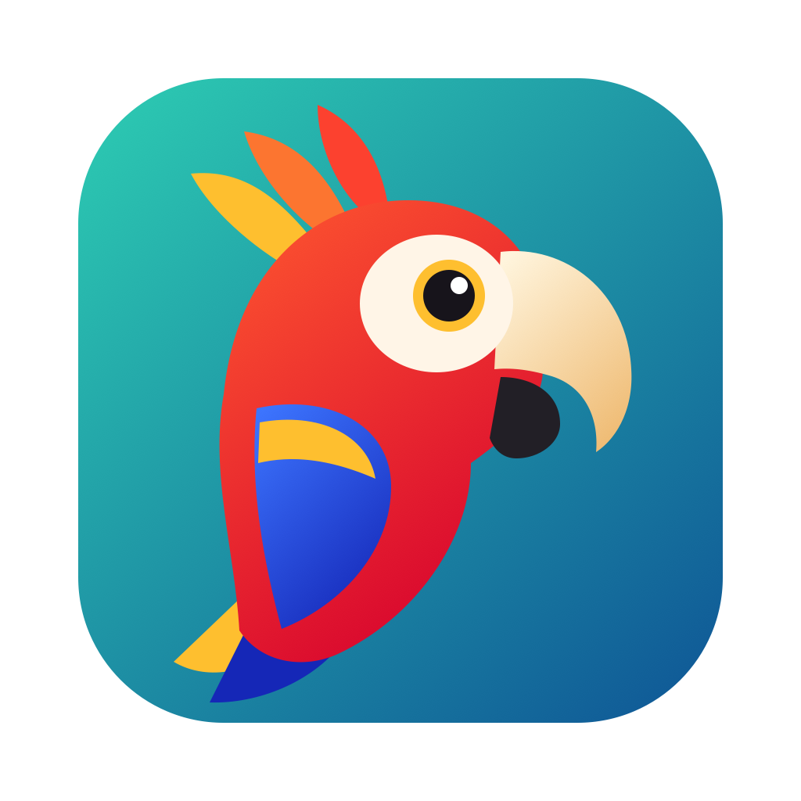

<p align="center">
  
</p>

<h1 align="center">Parrot</h1>

<p align="center"><b>Copie toute la transcription d'une réunion Microsoft Teams en un clic, sur Mac.</b></p>

Teams ne permet pas toujours de télécharger une transcription, et on ne peut en sélectionner que quelques minutes à la fois. Pour un entretien de 40 minutes, il faut recommencer des dizaines de copier-coller.

Parrot le fait à ta place : il fait défiler la transcription tout seul, récupère chaque réplique et copie le tout. Il ne reste plus qu'à coller le texte dans Claude ou ChatGPT.

## La démo en 20 secondes

https://github.com/user-attachments/assets/5bd7b7c6-1cce-4e2a-920f-8ba4604af3f2

<sub>Vidéo réalisée avec des données fictives.</sub>

## Ce que fait Parrot

- **Copie complète** : toute la transcription, avec les noms et les heures, en une dizaine de secondes pour 20 minutes de réunion.
- **Suivi en direct** : un perroquet animé et une barre de progression pendant la copie.
- **Nettoyage du texte** : retire les « euh », fusionne les répliques d'une même personne, masque les heures si tu veux.
- **Claude et ChatGPT** : un clic ouvre une nouvelle conversation et y colle le texte. Rien n'est envoyé sans toi.
- **Export** : Word, PDF ou TXT, dans ton dossier Téléchargements.
- **Photos des intervenants** (facultatif) : affichées à la place des initiales.

## Ce qu'il te faut

- Un **Mac** avec un compte **administrateur**.
- La **nouvelle application Microsoft Teams**, en **français ou en anglais**.
- Une réunion avec une **transcription** disponible.

Parrot ne fonctionne pas sur Windows ni sur Linux, ni avec Teams dans un navigateur.

> **À vérifier avant de l'utiliser :** si ton entreprise a bloqué le téléchargement des transcriptions, assure-toi que cet outil est autorisé. Une transcription contient les propos d'autres personnes : vérifie aussi que tu peux les envoyer à une IA.

## Installation

### 1. Télécharger Parrot

En haut de cette page, clique sur le bouton vert **Code**, puis sur **Download ZIP**. Ouvre ensuite le fichier téléchargé pour le décompresser.

### 2. Lancer l'installation

1. Ouvre l'app **Terminal** (⌘ Espace, puis tape « Terminal »).
2. Copie cette commande, colle-la dans Terminal, puis appuie sur Entrée :

   ```bash
   cd ~/Downloads/parrot-main && zsh install.sh
   ```

Si le dossier n'est pas dans Téléchargements, tape `cd `, fais-le glisser dans Terminal, appuie sur Entrée, puis lance `zsh install.sh`.

Quand `Terminé.` s'affiche, **Parrot** est dans ton dossier Applications.

### 3. Autoriser Parrot (une seule fois)

Parrot lit la fenêtre de Teams grâce à l'accessibilité de macOS, comme un lecteur d'écran. macOS demande ton accord :

1. Ouvre **Réglages Système > Confidentialité et sécurité > Accessibilité**.
2. Clique sur **+**, choisis **Parrot** dans Applications, puis active l'interrupteur.
3. Au premier lancement, si macOS demande que Parrot contrôle **System Events**, clique sur **OK**.

**Pour avoir les photos des intervenants (facultatif) :** fais la même chose dans **Enregistrement de l'écran**. Sans cette autorisation, Parrot marche normalement et affiche les initiales. macOS peut redemander de temps en temps de confirmer cet accès.

### 4. Créer un raccourci clavier (facultatif)

1. Ouvre l'app **Raccourcis** et crée un nouveau raccourci.
2. Ajoute l'action **Ouvrir l'app** et choisis **Parrot**.
3. Clique sur **ⓘ**, puis sur **Ajouter un raccourci clavier**, et appuie par exemple sur ⌃⌥T.

## Utilisation

1. Dans Teams, ouvre la réunion, puis l'onglet **Transcription**.
2. Lance Parrot avec ton raccourci, depuis ⌘ Espace ou depuis Applications. Ne touche pas à Teams pendant la copie.
3. À la fin, la transcription est déjà dans ton presse-papiers, et une fenêtre apparaît par-dessus Teams.
4. Clique sur **Claude** ou **ChatGPT** pour coller le texte dans une nouvelle conversation, puis envoie-le toi-même.

| Dans la fenêtre | Action |
|---|---|
| Icône de réglages | Choisir le nettoyage du texte |
| **Word**, **PDF**, **TXT** | Exporter dans Téléchargements |
| **Entrée** | Coller dans ton dernier assistant utilisé |
| **1** / **2** | Coller dans Claude / ChatGPT |
| **Échap** | Fermer |

Exemple de texte copié :

```
[0:00] Marie Dupont : Bonjour à tous, on commence ?
[0:06] Paul Martin : Oui, je partage mon écran.
```

Avant de coller dans une app, vérifie la conversation qui s'ouvre : selon l'app et l'onglet affiché, le raccourci de nouvelle conversation peut se comporter différemment.

## Confidentialité

Parrot n'a ni compte, ni serveur, ni connexion à Internet, et n'utilise aucune API de Microsoft. Il lit seulement ce que Teams affiche à l'écran. Le texte ne quitte ton Mac que lorsque tu l'envoies toi-même à une IA.

Sur ton Mac, Parrot conserve la dernière transcription, les photos récupérées et tes préférences dans `~/Library/Application Support/Transcription Teams/`.

## Dépannage

| Problème | Solution |
|---|---|
| **« Il faut autoriser Parrot »** alors qu'il est activé | L'autorisation correspond à une ancienne version. Dans Accessibilité, retire Parrot avec **−**, ajoute-le à nouveau avec **+**, puis active-le. |
| **« Je ne trouve pas la transcription »** | Ouvre l'onglet Transcription de la réunion. Vérifie que Teams est en français ou en anglais. |
| **« Impossible d'afficher la fenêtre de Teams »** | Vérifie que l'écran n'est pas verrouillé et que la fenêtre de Teams est ouverte. |
| **Pas de photos** | Active Parrot dans Enregistrement de l'écran. |
| **Ajouter Parrot avec + ne marche pas** | Fais glisser Parrot depuis le dossier Applications dans la liste. |

## Mettre à jour

Télécharge la nouvelle version, puis relance `zsh install.sh`. Ton autorisation est conservée, car `Parrot.app` n'est pas reconstruite.

## Désinstaller

1. Supprime **Parrot** du dossier Applications.
2. Retire Parrot d'**Accessibilité** et d'**Enregistrement de l'écran**.
3. Dans Terminal, supprime ses données :

   ```bash
   rm -rf ~/Library/Application\ Support/Transcription\ Teams
   ```

## Limites

- Parrot dépend de l'interface de Teams : une mise à jour de Teams peut l'empêcher de fonctionner.
- Testé sur un seul Mac et sur Teams en français. Les autres configurations n'ont pas été testées.
- La barre de progression est une estimation, basée sur le créneau prévu de la réunion.
- Le PDF sort sur une seule longue page.

## Comment ça marche

1. Parrot lit la fenêtre de Teams grâce à l'accessibilité de macOS (`AXEnhancedUserInterface`, via System Events).
2. Teams ne garde qu'une partie des répliques en mémoire. Parrot en lit une tranche, demande d'afficher la dernière réplique lue (`AXScrollToVisible`), et recommence jusqu'à la fin.
3. À chaque étape, il vérifie que la liste n'a pas bougé pendant la lecture et que la dernière ligne lue est encore présente. Sinon, il revient en arrière.
4. Il retire les doublons, trie les répliques par heure et copie le texte.
5. La fenêtre de fin est une app séparée, sans autorisation particulière : une page web dans une fenêtre macOS native.

### Les fichiers

| Fichier | Rôle |
|---|---|
| `install.sh` | Installe ou met à jour Parrot |
| `src/lanceur.js` | Contenu de `Parrot.app` : charge simplement les fichiers ci-dessous |
| `src/transcription-teams-app.js` | Lit la transcription dans Teams |
| `src/widget.js` | La fenêtre : progression, nettoyage, exports |
| `src/widget-app.js` | Lance la fenêtre dans `Parrot Widget.app` |
| `assets/` | Logo |

`Parrot.app` n'est qu'un petit lanceur parce qu'elle est signée sans compte développeur Apple : macOS relie alors l'autorisation à l'empreinte exacte de l'app. Reconstruire l'app ferait perdre l'autorisation, alors que le reste peut évoluer librement. Pour la reconstruire quand même : `zsh install.sh --rebuild-app`.

Test en ligne de commande, sans fenêtre de fin :

```bash
osascript -l JavaScript src/transcription-teams-app.js --debug
```

## Licence

Parrot est distribué sous [licence MIT](LICENSE) : tu peux l'utiliser, le modifier et le partager librement, à condition de conserver ce fichier de licence. Le logiciel est fourni tel quel, sans garantie.

Parrot est un projet indépendant, sans lien avec Microsoft, Anthropic ou OpenAI.
